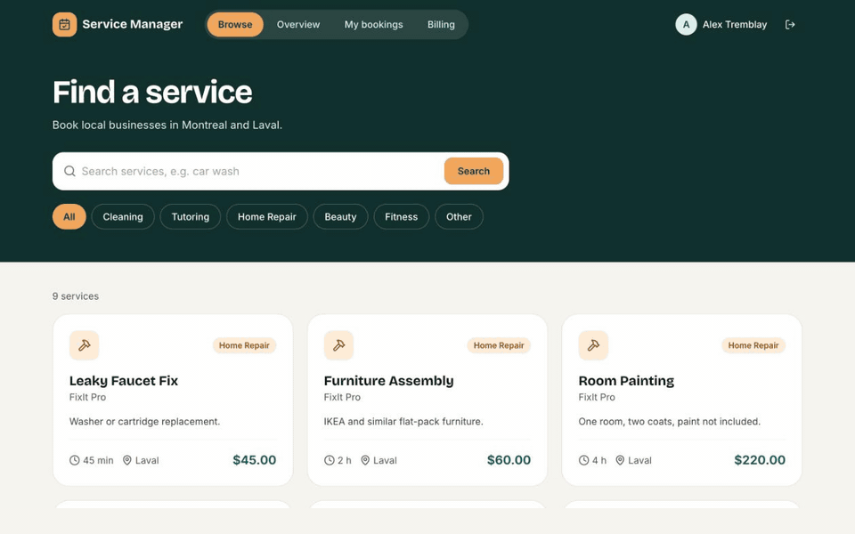
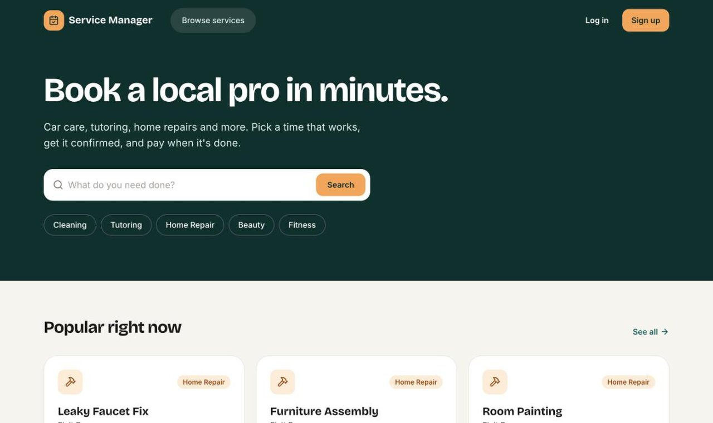
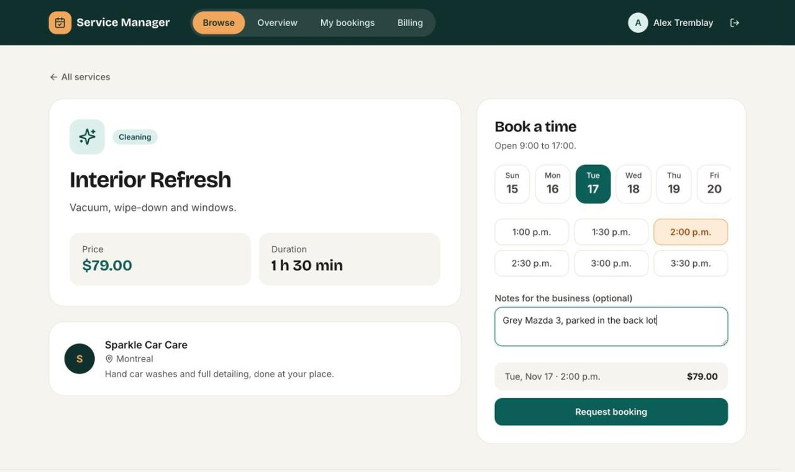
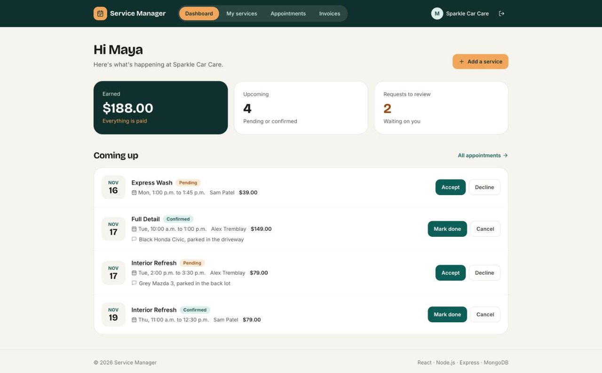
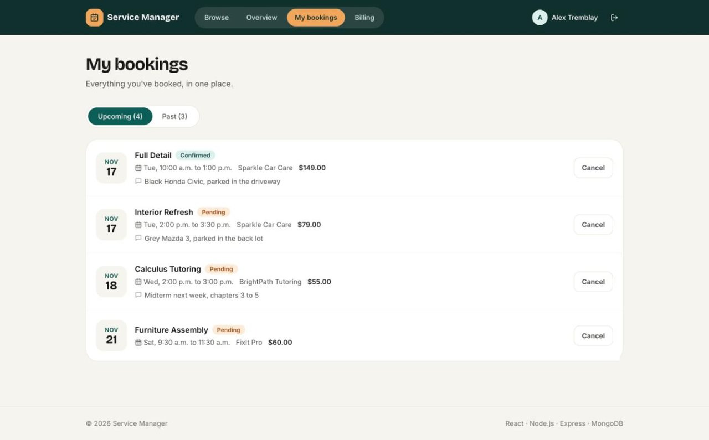

# Service Manager

A full-stack web app for booking local services like car detailing, tutoring or small home repairs. Customers find a service, pick an open time and request a booking. Businesses list their services, accept or decline requests, and get paid through invoices once a job is done.

Built with **React + TypeScript** on the front end, **Node.js / Express** for the API and **MongoDB** for the database.



| | |
|---|---|
|  |  |
|  |  |

## Features

**Customers**
- Search services and filter by category
- See open time slots for the next two weeks and request a booking
- Track bookings (pending, confirmed, completed) and cancel if needed
- Pay invoices for finished jobs (no real payment, it just marks them as paid)

**Businesses**
- Add, edit, hide and delete services
- Accept or decline booking requests and mark jobs as done
- An invoice is created automatically when a job is marked done
- Dashboard with upcoming bookings and money earned

**Both:** sign up, log in and edit your profile.

## How it works

```
React (Vite)  ──/api──►  Express API  ──►  MongoDB
   :5173                   :3000
```

- Passwords are hashed with bcrypt. Logging in stores a JWT in a cookie, and each route checks that you're logged in with the right account type.
- Time slots: businesses are open 9:00 to 17:00. The server goes through the day in 30-minute steps and keeps the times where the service fits without overlapping another booking.
- When a booking is made, the server checks for overlaps again so the same time can't be booked twice.

More notes are in [docs/DESIGN.md](docs/DESIGN.md).

## Running it

You need **Node.js 20+**.

```bash
npm install
npm run dev:memory    # API + web app with a temporary database and demo data
```

Then open http://localhost:5173. Demo accounts (password `demo1234`), also on the login page as buttons:
- Customer: `alex@example.com`
- Business: `maya@sparkle.ca`

To use a real MongoDB instead (data is kept between restarts):

```bash
docker compose up -d   # starts MongoDB
npm run seed           # adds the demo data
npm run dev
```

## Tests

```bash
npm test
```

12 API tests (Vitest + Supertest) run against an in-memory MongoDB. They cover sign up and login, creating and editing services, the full booking → invoice → payment flow, double booking, and who can see or change what. GitHub Actions runs them on every push.

## Project structure

```
client/src/pages/       pages (browse, booking, dashboard, appointments, invoices, profile)
client/src/components/  layout, service cards, appointment rows, shared UI
server/src/models/      User, Service, Appointment, Invoice
server/src/routes/      auth, services, appointments, invoices, dashboard
server/test/            API tests
```

## Credits

The first version of this app was built with two collaborators as plain HTML/JS pages. I later rebuilt it with React, Express and MongoDB.
